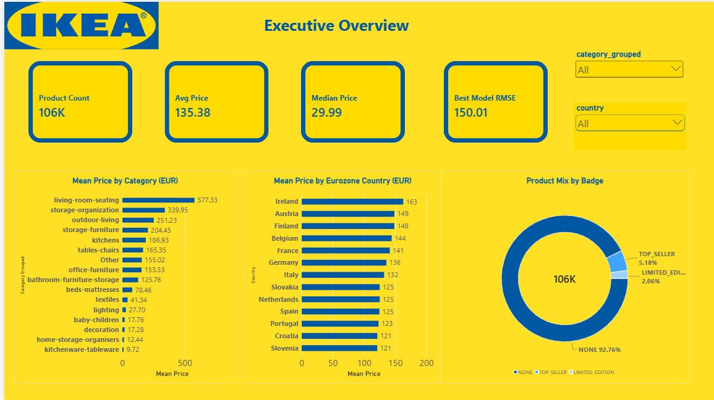
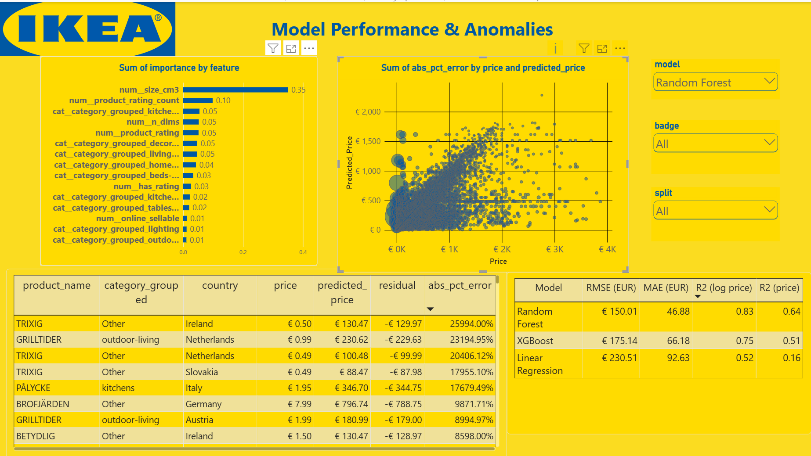
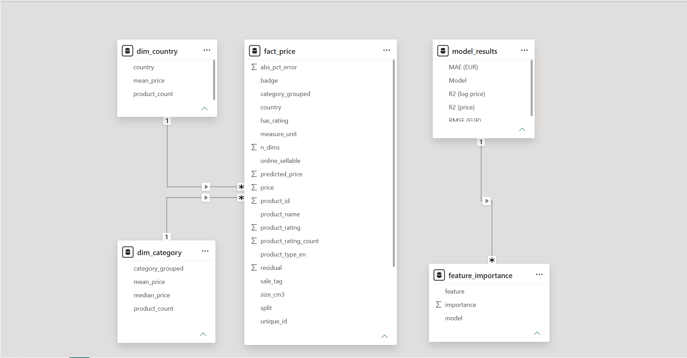

# IKEA Global Pricing Analytics

**Predicting product prices and flagging pricing anomalies across 13 Eurozone markets with machine learning and Power BI.**

`Python` · `pandas` · `scikit-learn` · `XGBoost` · `Power BI` · `DAX`



## The business question

IKEA sells largely the same products in many countries. Within the Eurozone, every market uses the euro, so prices should be fairly consistent. This project asks three questions:

1. **How consistent are IKEA's prices across Eurozone markets?**
2. **Which product features drive price?**
3. **Which listings look over- or under-priced compared with similar products?**

## Key results

| | |
|---|---|
| Listings analysed | **105,671** listings, 14,350 products, 13 Eurozone markets (from 401,046 global listings) |
| Best model | **Random Forest**: R² = 0.64 on price (0.83 on log price), MAE €46.88 |
| Price consistency | Market averages vary by **9.8%**, falling to **3.4%** for the 3,598 products sold in all 13 markets |
| Main price drivers | Product **size** and **category** |
| Honest check | Testing on products the model had never seen lowered R² to **0.52**, so the headline score is optimistic for new products |

**What it means for a pricing team:** prices are broadly consistent between markets, but individual products still vary. That makes product-level monitoring more useful than comparing market averages. The flagged listings are prompts for review, not proof of a pricing error.

## Approach

1. **Fix inconsistent labels.** The same product carried different category names in different countries (65.3% of products). 314 local labels were mapped to one English category list, using English-language storefronts as the reference.
2. **Scope to the Eurozone.** Keeping to one currency removes exchange-rate noise, so remaining price gaps reflect real pricing differences.
3. **Engineer features.** Product size was parsed from free-text measurements, categories were grouped into the top 15 plus "Other", and rating fields were cleaned with a `has_rating` flag.
4. **Model.** Linear Regression, Random Forest and XGBoost were trained on log price inside a scikit-learn pipeline, with preprocessing fitted on training data only to avoid leakage (80/20 split).
5. **Validate honestly.** A supplementary product-grouped split tested performance on genuinely unseen products.
6. **Visualise.** A star-schema data model feeds a two-page Power BI dashboard.

### Model comparison (held-out test set)

| Model | RMSE (€) | MAE (€) | R² (price) | R² (log price) |
|---|---|---|---|---|
| **Random Forest** | **150.01** | **46.88** | **0.64** | **0.83** |
| XGBoost | 175.14 | 66.18 | 0.51 | 0.75 |
| Linear Regression | 230.51 | 92.63 | 0.16 | 0.52 |

## Power BI dashboard

**Page 1, Executive Overview:** KPI cards, mean price by category and by country, product mix by badge, plus category and country filters (shown at the top).

**Page 2, Model Performance & Anomalies:** model comparison, feature importance, actual vs predicted prices, and an anomaly table ranked by percentage error.



The data model is a star schema: one `fact_price` table (105,671 rows) linked to `dim_category` and `dim_country`, with model results and feature importance alongside.



## Repository structure

```
IKEA-Global-Pricing-Analytics/
├── notebooks/
│   └── IKEA_price_analysis.ipynb   # cleaning, feature engineering, modelling, figures
├── data/
│   ├── README.md                   # where to get the raw data
│   └── processed/                  # cleaned data and star-schema tables used in Power BI
├── results/                        # model_results.csv, feature_importance.csv
├── images/                         # analysis figures and dashboard screenshots
└── powerbi/
    └── IKEA_Pricing_Dashboard.pbix
```

## How to run it

1. Download `IKEA_product_catalog.csv` from Kaggle (see [data/README.md](data/README.md)).
2. Open `notebooks/IKEA_price_analysis.ipynb` in Google Colab or Jupyter. In Colab, the first data cell asks you to upload the file; locally, put the file next to the notebook.
3. Run all cells. The notebook recreates the files in `data/processed/` and `results/`.
4. Open `powerbi/IKEA_Pricing_Dashboard.pbix` in Power BI Desktop to explore the dashboard.

**Requirements:** Python 3.9+, `pandas`, `numpy`, `matplotlib`, `seaborn`, `scikit-learn` (1.2 or later), `xgboost`. Install with `pip install -r requirements.txt`.

## Limitations

- Hyperparameters were not tuned with cross-validation; sensible defaults were used.
- The main train/test split was random rather than grouped by product, which inflates accuracy (see the honest check above).
- About 15% of Eurozone rows had no English-language category reference and were left out.
- Findings apply to the 13 Eurozone markets only.
- The model explains and audits prices; it does not recommend optimal prices.

## About

Built by **Baljeet Singh** for the Business Data Analytics course (MBI806B), Master of Business Informatics (Business Analytics), Yoobee College of Creative Innovation, 2026.

[LinkedIn](https://www.linkedin.com/in/baljeet-singh2001) · [GitHub](https://github.com/baljeetatwork)

*Data: IKEA Global Product Catalog and Price 2026, Kaggle. This is an independent student project, not affiliated with or endorsed by IKEA.*
